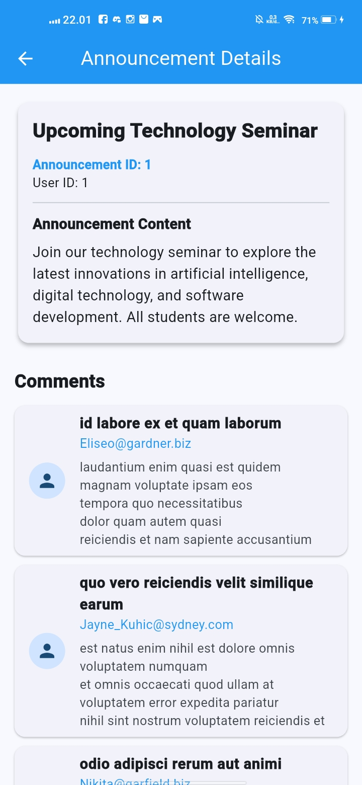
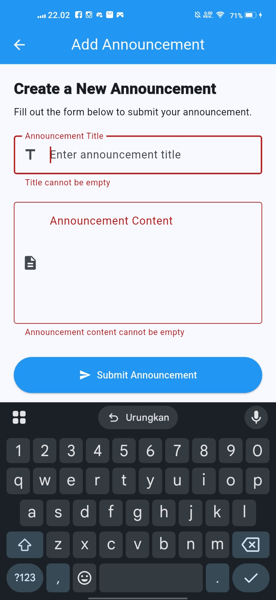
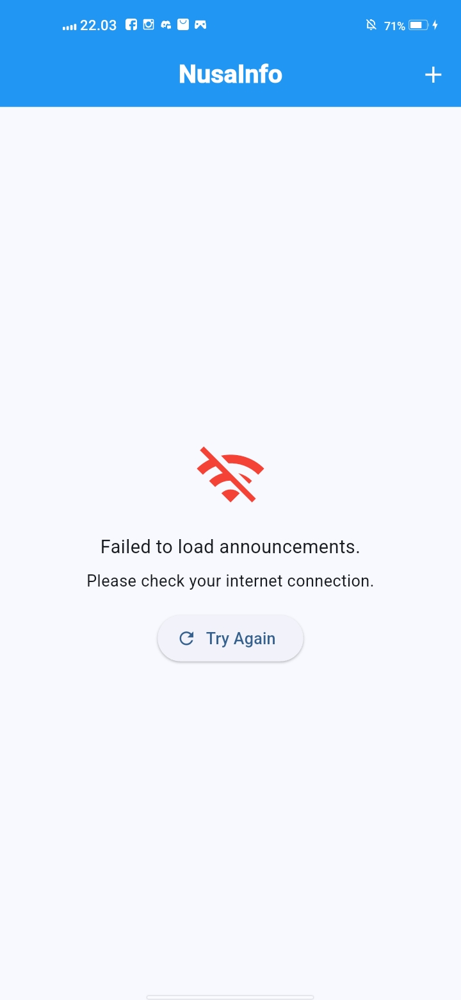

# NusaInfo — Flutter API Integration

NusaInfo is a simple Flutter application that displays announcements using the JSONPlaceholder REST API.

## Features

- Fetch announcements using HTTP GET.
- Display announcement details.
- Retrieve comments from the API.
- Add announcements using HTTP POST.
- Form validation using `GlobalKey<FormState>`.
- Loading and error states.
- Retry button when an internet connection fails.
- Pull-to-refresh using `RefreshIndicator`.
- Success notification using SnackBar.

## API Used

Base URL: https://jsonplaceholder.typicode.com

| Method | Endpoint | Description |
|---|---|---|
| GET | `/posts` | Fetch announcements |
| GET | `/posts/{id}/comments` | Fetch announcement comments |
| POST | `/posts` | Submit a new announcement |

## Project Structure

```text
lib/
├── models/
│   └── post.dart
├── services/
│   └── post_service.dart
├── screens/
│   ├── home_screen.dart
│   ├── detail_screen.dart
│   └── add_post_screen.dart
└── main.dart
```

## Application Screenshots

### 1. Home Screen


### 2. Detail Screen



### 3. Add Announcement Screen


### 4. Form Validation



### 5. Offline Error Handling



### 6. Successful Submission Notification


## Installation and Running

1. Clone this repository.
2. Open the project folder.
3. Install dependencies:

```bash
flutter pub get
```

4. Run the application:

```bash
flutter run
```

## Technologies

- Flutter
- Dart
- HTTP package
- JSONPlaceholder REST API

## Author

Nazwa Khairunnisa Hakiki